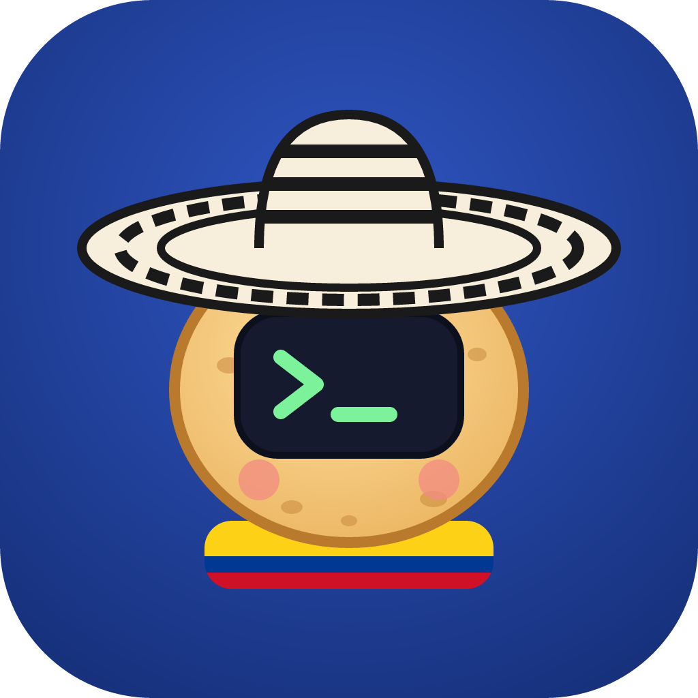

<p align="center">
  
</p>

<h1 align="center">parcerito</h1>

<p align="center">
  Your coding <i>parcero</i> in Slack. <b>Claude</b> plans and reviews, <b>Codex</b> writes the code, you get a PR.
</p>

---

Mention `@parcerito` in Slack with a bug, a Linear ticket, or a Sentry error. It investigates the codebase, writes a plan,
hands the implementation to Codex, reviews the diff, runs the tests, and opens a draft PR, posting progress in the
thread as it goes. For example:

```
you: @parcerito LIN-482 the export button times out for big workspaces, can you fix it?

parcerito: ✅ Done in 6m 12s
  • Checking Linear
  • Searching for `exportWorkspace`
  • Handing the implementation to Codex
  • Codex edited export.ts, export.test.ts
  • Running `npm test -- export`
  The export ran one query per project; I had Codex batch it and stream the CSV instead.
  Tests pass. Draft PR: https://github.com/acme/api/pull/913
```

## Why two models?

Most agents use one model for everything. Parcerito splits the work the way a tech lead and a developer would:

| Role | Model | Does |
| --- | --- | --- |
| 🧠 Brain | Claude Opus 5.5 (Claude subscription) | Reads the ticket, explores the code, plans, reviews the diff, runs the tests, opens the PR |
| 🙌 Hands | GPT-6.1-Sol via Codex (ChatGPT subscription) | Writes the code from Claude's spec, then applies Claude's review feedback |

Writing code is where most of the tokens go, so this spreads the work across two subscriptions: limits last much
longer, and every change gets a second model's review before you see it.

## How it works

```
Slack (Socket Mode, no public URL needed)
  │  @mention / DM, allowlisted users only
  ▼
parcerito (Node + TypeScript, one Docker container)
  ├─ Claude Agent SDK ── the orchestrator
  │    ├─ open_repo          → a git worktree + branch per Slack thread
  │    ├─ delegate_to_codex  → Codex SDK runs GPT-6.1-Sol in that worktree
  │    ├─ Linear MCP, Sentry MCP (optional)
  │    └─ git / gh           → commit, push, `gh pr create --draft`
  └─ /data volume: repo clones, worktrees, Claude & Codex logins, thread sessions
```

- **One thread, one task.** Each Slack thread gets its own worktree and branch (`parcerito/<thread>`), so tasks never
  step on each other. Follow-ups in the thread (with an `@parcerito` mention) continue the same Claude session and the same Codex conversation.
- **Thread context.** Mention it inside an existing thread (a Sentry alert, a bug report) and it reads the thread first.
- **Only answers when mentioned.** In channels it ignores thread replies that don't tag it. DMs don't need a mention.
- **Acknowledges prompt and form issues in the agenda channels.** When someone outside the team posts in one of `AGENDA_CHANNELS`, it waits for the thread to go quiet for 3 minutes and classifies it as a prompt/form issue, another issue, or not an issue. Only prompt/form issues get a one-time reply in the thread saying it's on your plate. It stays out of threads anyone on the team (or it) already answered. Linear is still handled by the daily agenda.
- **Say `@parcerito stop`** in the thread to cancel the current run.

## Setup

You need a Claude Pro/Max subscription, a ChatGPT plan that includes Codex, a Slack workspace where you can install
apps (or an admin who will approve it), and a [Railway](https://railway.com) account. Any Docker host works too.

### 1. Create the Slack app

1. Go to [api.slack.com/apps](https://api.slack.com/apps) → **Create New App** → **From a manifest**, pick your
   workspace, and paste [`slack-manifest.yml`](slack-manifest.yml). Change the name to yours first.
2. **Basic Information → Display Information**: upload [`assets/parcerito-1024.png`](assets/parcerito-1024.png) as the icon.
3. **Basic Information → App-Level Tokens**: create one with the `connections:write` scope. That's `SLACK_APP_TOKEN` (`xapp-…`).
4. **Install App** to the workspace (or **Request to Install** and ask an admin). Copy the **Bot User OAuth Token**:
   that's `SLACK_BOT_TOKEN` (`xoxb-…`).
5. Get your own member ID (Slack profile → ⋮ → **Copy member ID**) for `ALLOWED_SLACK_USER_IDS`.

### 2. Get the tokens

| Variable | How |
| --- | --- |
| `CLAUDE_CODE_OAUTH_TOKEN` | Run `claude setup-token` on your machine. It's a 1-year token tied to your subscription. |
| `GH_TOKEN` | A [fine-grained token](https://github.com/settings/personal-access-tokens/new) for the repos: Contents and Pull requests read/write. |
| `LINEAR_API_KEY` (optional) | Linear → Settings → Security & access → Personal API keys |
| `SENTRY_ACCESS_TOKEN` (optional) | Sentry → Settings → User Auth Tokens, with the scopes listed in the [Sentry MCP README](https://github.com/getsentry/sentry-mcp) |

### 3. Deploy on Railway

1. **New Project → Deploy from GitHub repo** → pick your fork of this repo. Railway builds the `Dockerfile`.
2. Add a **Volume** to the service mounted at **`/data`**.
3. Add the variables from [`.env.example`](.env.example) under **Variables**.
4. Deploy. The logs should show `⚡ Parcerito is running as @parcerito`.

### 4. Log in to Codex (once)

Codex keeps its login in `/data/codex/auth.json`, so this survives redeploys.

1. In ChatGPT, open **Settings → Security** and enable **device code login for Codex**.
2. Open a shell in the container and log in:
   ```bash
   railway ssh            # from your machine, in the linked project
   codex login --device-auth
   ```
   Open the link it prints, enter the code, then restart the service.

Alternatively, set `CODEX_AUTH_JSON_B64` to `base64 < ~/.codex/auth.json` from a machine where you're logged in. It's
only used on first boot. Use a login dedicated to the bot: sharing one `auth.json` between your laptop and the server
can log one of them out when tokens refresh.

### 5. Try it

In Slack: `@parcerito what does the auth middleware in acme/api do?`, then something real:
`@parcerito fix LIN-123`.

## Daily meeting agenda (optional)

Every weekday at `AGENDA_TIME` (default 10:00 `America/Bogota`), parcerito reads the `AGENDA_CHANNELS` it's a member
of, picks the messages from people outside `AGENDA_INTERNAL_USER_IDS`, and checks that each one is tracked in Linear.
Untracked ones are added as a comment on a matching open issue, or filed in the `LINEAR_TEAM_KEY` team's Triage with
the `parcerito` label. It then DMs you an HTML agenda: items grouped by section, each with a proposed solution, a
"Decided" checkbox and a notes box, plus a button that copies the decisions so you can paste them back to parcerito.

Messages that aren't issues (thanks, status updates, questions already answered) are listed as skipped, with the
reason, instead of becoming agenda items. Run `npm run agenda` on your machine to download the latest agenda to
`AGENDA_LOCAL_DIR`, build the local review hub (every agenda plus Megan's issues, with the linked visits pulled
read-only from production) and open it in your browser. `--no-db` skips the production pull (cached visits only),
`--agenda-only` just opens the agenda; `npm run hub` rebuilds the hub alone. The hub holds PHI, so it stays on your
machine (`~/Desktop/Lime/review-hub`).

### Tracking in Linear Triage

Agenda issues are tracked in Linear (the Lime dashboard is retired; `--publish` still sends the hub there):

- **Titles** start with `[Agenda - YYYY-MM-DD] `, the newest agenda the issue was on. Issues parcerito files get it
  at creation; existing issues an agenda item points to are renamed (an older prefix is replaced, never stacked; a
  newer one is kept).
- **One "Agenda review — YYYY-MM-DD" comment** per issue and agenda date (marker
  `<!-- parcerito:agenda-review:YYYY-MM-DD -->`, updated in place). The Railway run posts the triage (summary,
  proposal, CMS verdict) — new issues get it in their description — and keeps the "More reports of this from Slack"
  comments. The local `npm run agenda` then replaces it with the full review: triage, classification, what the docs
  say, questions to resolve, possible duplicates, Slack reports, rejected AI suggestions and the newest 10 visits
  (AI value → final answer, who decided, reason, cited evidence; for fields without a suggestion, why and what the
  AI saw). It holds PHI by design and is capped at ~60k characters (oldest visits/fields trimmed with a "+N" line).
  Closed issues are left alone, and each issue prints one line (`✓ ENG-123 renamed + review updated`).
- **Flags** (`npm run agenda` and `npm run hub`): `--linear-dry-run` writes nothing and saves what it would send to
  `review-hub/linear-dry-run/` (mutations + each comment), `--no-linear` skips Linear, `--publish` also publishes
  to the Lime dashboard. `LINEAR_DRY_RUN=1` turns every Linear write (Railway, `agenda:local`, scripts) into a log line.
- **Duplicates**: each run compares the newest agenda's issues with the open loop issues (shared Slack thread or
  visit, shared OASIS codes and title words), asks Claude about the candidates (cached), lists them at the end and
  in the review comment. Nothing is marked automatically: `npm run duplicates` lists the high-confidence pairs from
  the last run; `npm run duplicates -- --apply` asks y/N, then marks the newer issue Duplicate of the older one
  (relation, Duplicate state, comment). `--all` also lists medium/low pairs.

Each window starts where the previous scheduled run ended (Mondays cover the weekend); the very first one starts at
`AGENDA_BACKFILL_SINCE`. DM `agenda` to build one on demand without moving the window. Needs `LINEAR_API_KEY`.

The agenda also has a "Rejected AI suggestions" section: form fields where a coder rejected or overwrote the AI's
value in production, grouped into patterns with proposed prompt changes. Without the shared Lime integration,
production reads use your AWS SSO login: `npm run rejected-fields` logs in if needed, opens the database
tunnel, exports the last 7 days and uploads them to your DM with the bot. Run it before the agenda (or run it, then
DM `agenda`).


**Weekday schedule (local).** `scripts/agenda-scheduled.sh` runs `npm run agenda -- --no-open` at 10:10 on weekdays via a
launchd agent (`~/Library/LaunchAgents/com.parcerito.agenda.plist`, log in `~/Desktop/Lime/review-hub/scheduled.log`).
It waits up to 30 min for today's agenda in the DM; if the AWS SSO session has expired it runs with `--no-db`
(triage only, no prod evidence). Log in to AWS before 10 to get the full review.

## Local development

```bash
cp .env.example .env   # fill it in; DATA_DIR defaults to ./data
npm install
npm run dev            # uses your local `claude` and `codex` logins if the tokens are unset
npm test
```

## Configuration

See [`.env.example`](.env.example) for every variable. The useful knobs:

| Variable | Default | |
| --- | --- | --- |
| `CLAUDE_MODEL` | `claude-opus-5-5` | The orchestrator |
| `CLAUDE_EFFORT` | `high` | `low` … `max` |
| `CODEX_MODEL` | `gpt-6.1-sol` | The implementer |
| `CODEX_EFFORT` | `medium` | `minimal` … `ultra` |
| `CODEX_SANDBOX` | `danger-full-access` | The container is the sandbox; use `workspace-write` on a host with sandboxing support |
| `BOT_NAME` | `Parcerito` | Name used in its replies |

## Security notes

- **Only allowlisted Slack users can trigger it.** It runs on personal subscriptions; don't share it with the team.
- Both agents run without permission prompts **inside the container**. Give it only the repos it needs, through a
  fine-grained GitHub token, and keep it on its own Railway service.
- It opens **draft PRs** on its own branches and is told never to push to the default branch or force-push. Branch
  protection on your default branch makes that a guarantee rather than a request.

## License

[MIT](LICENSE)

## Shared coder-feedback workspace

When `LIME_REVIEW_API_URL`, `LIME_REVIEW_INGEST_KEY`, and `LIME_REVIEW_WEB_URL` are
configured, the weekday agenda also publishes to Lime's employee-only
`/coder-feedback` page. Approved scoped answers feed the next agenda. A durable
background build enriches the shared queue through Lime's read-only evidence API;
failed builds and batched publications retry every five minutes. Live rejections
come from the backend, with the existing DM export as a fallback.

Private agency indexes and Megan topics are optional inputs via `AGENCY_DOCS_DIR`
and `LIME_REVIEW_TOPICS_FILE`; provisioning them is outside this rollout. The
dashboard retains published context and versioned human decisions without them;
the classifier cannot consult files absent from the worker. The public CMS index
is included in the Docker image. Do not commit private documents. Local hub builds
publish only with `--publish`; `npm run review:publish` imports only existing local caches and
`npm run review:publish -- --snapshot` replays the saved snapshot. Human decisions
survive imports. Decisions use the existing reviewed copy/paste flow for Linear;
saving an answer does not independently close issues or post to Slack.
